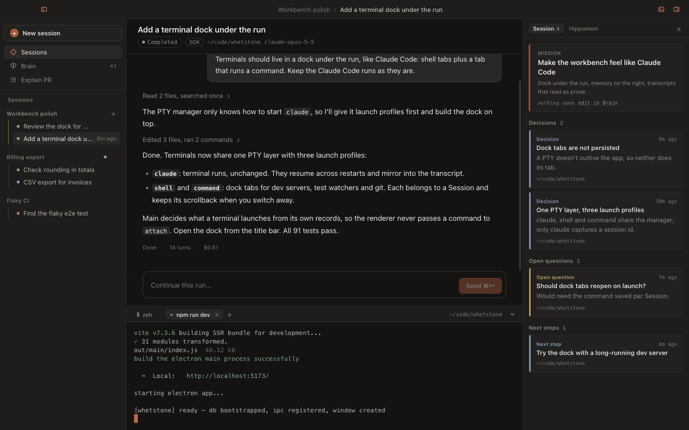
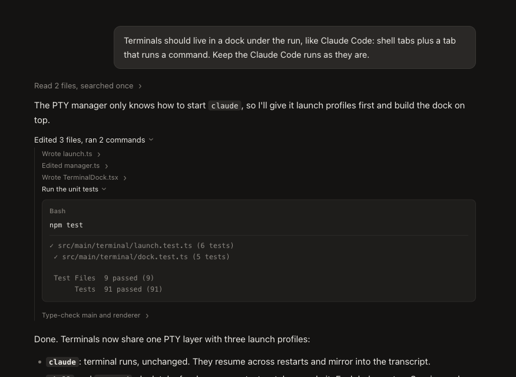

# Whetstone

An agentic development environment. **v1 foundation:** launch Claude agent runs
and group them into Sessions — captured as structured events, not terminal
scrollback.



> Direction and scope live in [`docs/whetstone-v1.md`](docs/whetstone-v1.md).

## Stack

- **Electron** — main (Node) + renderer (React), via `electron-vite`
- **Claude Agent SDK** (`@anthropic-ai/claude-agent-sdk`) — drives runs, structured stream
- **libSQL** (`@libsql/client`) + **Drizzle** — local on-disk SQLite, N-API (no native rebuilds)

## Run it

```bash
npm install
npm run dev
```

Launching an agent uses your **local Claude login** (same auth as the Claude Code
CLI) — no API key needed. Runs drive with **full permissions** in the chosen
directory (the agent may edit files and run commands without prompting — a
per-tool approval UI will replace this blanket grant later). Runs can also call
an in-process **`ask_user`** tool to ask you clarifying questions mid-run, which
render as answerable cards in the transcript.

Scripts:

| Command | What it does |
|---|---|
| `npm run dev` | Electron app with HMR |
| `npm run build` | Bundle main/preload/renderer to `out/` |
| `npm run typecheck` | Type-check both TS projects |
| `npm test` | Unit tests (Vitest; storage runs against in-memory SQLite) |

## Shape

```
src/
├─ shared/          Session · AgentRun · RunEvent + the IPC contract
├─ main/            db (libSQL+Drizzle) · repos · agent providers · ipc
├─ preload/         contextBridge → window.whetstone
└─ renderer/src/    React: Sessions · Runs · live Transcript
```

**Model:** a **Session** groups **AgentRun**s (each a resumable Claude
conversation, 1:1 with an SDK `session_id`, with its own working directory);
each run is a stream of structured **RunEvent**s — the substrate future memory
and search build on.

Data lives at `~/Library/Application Support/whetstone/whetstone/whetstone.db`.

## The workbench

Laid out like Claude Code: Sessions and their runs in the sidebar (⌘B), the
selected run in the middle, terminals docked beneath it (⌃\`) and memory in a
panel on the right (⌘⇧M).

- **Terminals.** One PTY layer (`src/main/terminal/`) runs three profiles:
  `claude` (a terminal *run*: resumable, mirrored into RunEvents), `shell` and
  `command` (dock tabs for dev servers, test watchers, git). Dock tabs belong to
  a Session and live as long as the app. Main decides what a terminal launches,
  never the renderer.
- **Memory panel.** *Session* is the Session's working memory (what its runs
  `remember`). *Hippomem* reads the team's engineering decisions for the run's
  repo from a local [Hippomem](https://github.com/z10-labs/hippomem) server
  (`hippomem serve`), and can install Hippomem's Claude Code hooks in the repo
  so terminal runs read and write it on their own.
- **Transcripts.** Claude's replies read as prose, and the work between them
  folds into one line per stretch of tool calls. Open a line to see each call,
  and a call to see its input and output.

  

*Screenshots use seeded demo data.*

## Deferred (seam-ready, not built)

Permission UI · worktree isolation · importing existing `~/.claude` sessions ·
memory · integrations · plugins · orchestration · more providers.
